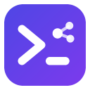

<p align="center">
  
</p>

<h1 align="center">Coding Agent</h1>

<p align="center">
  A local workspace for running many coding agents side by side, with orchestration and memory.
</p>

> **Based on [Alethe](https://github.com/Kc1t/alethe-agents)** by Kauã Miguel (AGPL-3.0-or-later).
> Coding Agent is an independent, modified version. It is not an official Alethe release and is
> not endorsed by its author. See [NOTICE](NOTICE).

## What it is

A desktop app (Tauri, Rust, React, xterm.js) where every pane is a real terminal. Run Claude
Code, Codex, Copilot CLI, Cursor, Antigravity, OpenCode, Kimi and other CLIs, plus shells and
WSL, organized into groups, projects and split panes. Scrollback is saved and agent sessions
resume after a restart.

## Coding Opus, built in

The app installs the **`coding`** skill (Coding Opus) for Claude Code and Codex:

| Pillar | What it does |
| --- | --- |
| **Memory** | a global second brain in `Documents/second brain`, read before answering and planning |
| **Orchestration** | playbooks, cheaper workers for bounded units, quota tracking and a cost report |

Playbooks edited under *Preferences ▸ Playbooks* are saved to
`%APPDATA%\CodingOpus\coding-opus-playbooks.yaml` (`~/.config/coding-opus/` on macOS and Linux),
the same file the skill reads. Inside an agent, use `/coding` (Claude Code) or `$coding` (Codex).

## Build from source

Requirements: Node.js 18+, stable Rust and, on Windows, Visual Studio Build Tools with C++.

```bash
npm install
npm run app
```

Build the installer (Windows, from a shell with `vcvars64` loaded):

```bash
npm run tauri build
```

Tests: `npm test` (frontend) and `npm run test:rust` (backend).

## What still needs your own infrastructure

Some Alethe features depended on its author's services, so they are switched off or point at this
repository instead:

| Feature | State | To enable |
| --- | --- | --- |
| Automatic updates | off | create a signing key with `npx tauri signer generate`, put its public key in `plugins.updater.pubkey` in `src-tauri/tauri.conf.json`, set `bundle.createUpdaterArtifacts` to `true` and publish `latest.json` with each release |
| Plugin catalog | example plugin only | edit [`plugins.json`](plugins.json) in this repository |
| Cloud sync | no server | set `CODING_AGENT_SYNC_SERVER_URL` and `CODING_AGENT_SYNC_GITHUB_CLIENT_ID` |

Installers are attached to each [release](https://github.com/oigorbrazil/coding-agent/releases).
They are not code-signed, so Windows SmartScreen may warn on first launch.

## Local data

Per profile, in `%LOCALAPPDATA%\com.codingagent.desktop\profiles\<profile>` on Windows: `projects.json`
(layout), `scrollback\*.bin` (terminal history) and `spawn.log`. The skill keeps its state in
`%APPDATA%\CodingOpus`. Alethe's folders are never read.

## Privacy and network notes

Kept from Alethe's disclosures, which still describe this codebase:

- “Local-first” describes workspace persistence, not an internet-free guarantee.
- Provider usage checks run by default; update checks and provider usage polling are on by default in the code, although this build has no update channel until you publish one.
- Manual GitHub Gist Sync is already available; cloud sync needs a server you configure.
- Handing a conversation from one agent to another sends a locally redacted context packet. Redaction is best effort.
- Remote Control is off by default and uses unencrypted HTTP/WebSocket transport on the LAN.
- Clean profiles are read-only.

Details in [SECURITY.md](SECURITY.md) and [docs/PRIVACY.md](docs/PRIVACY.md).

## License

Code under [AGPL-3.0-or-later](LICENSE). Anyone who distributes a modified version, or offers it
over a network, must publish the matching source. The Alethe name, logo and branding are not
covered by that license ([TRADEMARK.md](TRADEMARK.md)).
